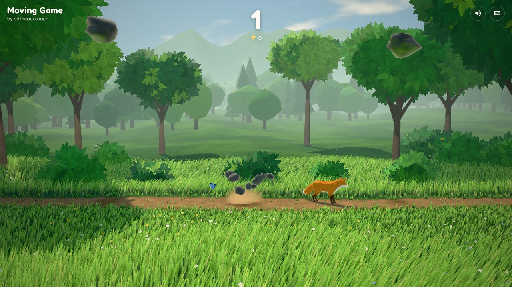

# Moving Game

A small fox dodging falling rocks in a living forest meadow. Built with three.js and WebGL, with no build step.



- **New version (3D):** `index.html` at the site root
- **Original version (2D canvas):** [`original/`](original/), kept exactly as it was and still playable on GitHub Pages at `/original/`

## Gameplay

Same simple rules as the original. Move left and right to dodge the rocks. Every second you survive is one point, and the rocks fall faster and more often over time.

| Action | Keyboard | Touch / mouse |
|---|---|---|
| Move | `←` `→` or `A` `D` | Hold the on-screen arrows, or hold the left or right half of the screen |
| Restart after game over | `Space` / `Enter` | ↻ button |
| Pause | `Esc` / `P` | Pauses automatically when the tab is hidden |

The game starts on your first move. Your best score is saved in the browser.

## What changed in the upgrade

- **Character:** a rigged low-poly fox with blended *idle → walk → run* animation (speeds matched to stride), turning, leaning, dust kicks, and a knock-out tumble with dizzy stars.
- **Nature (lush and green by default):**
  - procedural terrain with a winding dirt path
  - ~80k instanced grass blades with wind gusts, bending away from the fox
  - flower patches
  - stylised "fluffy" trees and bushes: leaf-card canopies, wind sway, leaf flutter and light shining through leaves
  - a distant forest, hazy hills and mountains
- **Sky and light:**
  - shader sky with sun and moon, drifting fbm clouds and twinkling stars
  - sun shadows, hemisphere light, and image-based lighting generated from the sky
  - aerial fog
- **Post-processing:**
  - MSAA and subtle bloom
  - colour grading and vignette
  - desaturation and slow motion on game over
- **Life:**
  - pollen motes by day, fireflies at night
  - butterflies, a passing flock of birds, falling leaves
- **Rocks:** procedural mossy rocks with a ground shadow that grows as they fall. They shatter into debris and dust on impact, with a small camera shake.
- **Sound:** all synthesised with WebAudio (wind, birdsong or crickets, impacts, chimes), so there are no audio files. A mute button is in the corner.
- **Weather follows your score:** every run starts on a lush green day. Every 8–10 points the scene drifts to the next look: Day → Autumn → Sunset → Night → Day, and so on. Each change blends over about 3.5 seconds (sky, light, sun and moon, fog, leaves, grass, sounds). Starting a new run brings back the green day.
- **The game UI has no guide text.** It shows only icons, the score and the game-over card.

## Works anywhere GitHub Pages does

- Everything is local, with no CDN at runtime: three.js (`vendor/three`), the fox model (`models/`) and the font (`fonts/`). All other assets are generated in code.
- Plain ES modules with an import map, so there is no bundler and nothing to build.
- **Adaptive quality.** The starting tier depends on the device. The game then lowers the resolution, grass density, post-processing and shadows if the frame rate drops. You can force a tier with `?q=0`, `?q=1` or `?q=2`.
- Responsive from phones (portrait or landscape, safe areas, touch controls) to ultrawide screens. The play field adapts to the screen shape.
- If a browser has no WebGL or import-map support, it is sent to the original version automatically.

## Deploy to GitHub Pages

GitHub Pages has to be switched on once in the repository settings. The workflow's built-in token is not allowed to do this. Choose **one** source:

1. **GitHub Actions (recommended):** open *Settings → Pages → Build and deployment* and set **Source** to **GitHub Actions**. Then open the *Actions* tab, choose **Deploy to GitHub Pages**, and click **Re-run all jobs** (or **Run workflow**). After that, every push to `main` deploys automatically.
2. **Deploy from a branch:** set **Source** to *Deploy from a branch*, then choose `main` and `/ (root)`. The site is fully static and `.nojekyll` is included. With this option the workflow only reports a notice and skips the deploy.

If Pages is still off, the workflow stops with a clear "GitHub Pages is not enabled" message.

The site will be at `https://<user>.github.io/moving_game/`, with the original at `https://<user>.github.io/moving_game/original/`.

## Run locally

Any static server works, for example:

```bash
python3 -m http.server 8000
# open http://localhost:8000
```

Opening the file directly with `file://` does not work, because browsers block ES modules there.

## Project layout

```
index.html          new 3D game
css/style.css       HUD / overlays
js/main.js          renderer, game loop, states, camera, adaptive quality
js/core/            shared uniforms + GLSL noise/wind, weather palettes, post-processing, audio, UI/input, canvas textures
js/world/           sky, terrain + ridges, grass, flowers, trees, ambient life
js/game/            fox (player), rocks, effects (dust / debris)
models/Fox.glb      animated fox
vendor/three/       three.js r186 + the few addons used
original/           the original 2D game, untouched
```

See [CREDITS.md](CREDITS.md) for asset licences.
